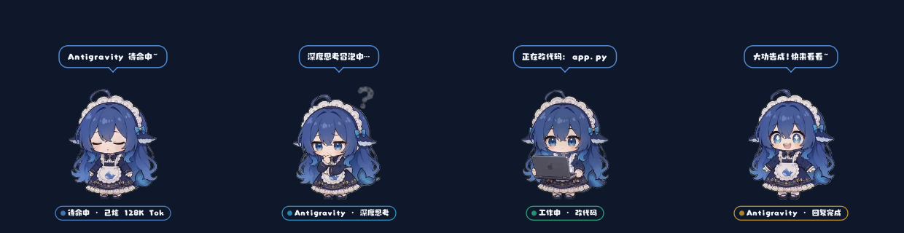

<div align="center">

# 🐋 Antigravity × DeepSeek 鲸鱼娘桌面宠物

**把社区爆火的「吃白饭的蓝色大肥鱼（DeepSeek 鲸鱼娘）」搬到 Google Antigravity！**

114 段原生透明 24 FPS 动画 · 实时同步 Antigravity 思考 / 写代码 / 调工具 / 完工状态 · 实时炫 Token 统计 · 拎起甩抛撞边物理

[](https://www.python.org/)
[](https://www.riverbankcomputing.com/software/pyqt/)
[](#快速安装)
[](LICENSE)



</div>

---

## ✨ 核心特性

- **100% 原汁原味「蓝色大肥鱼」114 段透明动画**
  - 使用 PyAV (`libvpx-vp9`) 零拷贝实时流式解码播放透明 VP9 WebM 动画，**内存占用极低、动作切换毫秒级无卡顿**。
  - 动画、糖果字体与音效素材均来自开源项目 [PC2005-cloud/dsh-pet](https://github.com/PC2005-cloud/dsh-pet)（MIT 协议），支持一行命令自动下载（无需手动找包）。
- **Google Antigravity 实时工作状态同步（双引擎）**
  - **引擎 1（实时会话日志追踪）**：200ms 轻量增量读取 `~/.gemini/antigravity*/brain/*/.system_generated/logs/transcript.jsonl`，**当前已打开的对话和新会话均可实时同步**，且自动区分主对话与 Subagent，不会误报完工。
  - **引擎 2（全局 Lifecycle Hooks）**：一键配置 `~/.gemini/config/hooks.json` 通过本地 UDP (`127.0.0.1:39481`) 零阻塞推送事件（桌宠未运行时自动忽略，不改动任何工具权限策略）。
- **按工具类型精准匹配动作**：

| Antigravity 实时状态 | 鲸鱼娘播放动画 | 状态胶囊 |
| :--- | :--- | :--- |
| 收到提问 / 深度思考 | `工作状态-思考冒泡` / `深度思考碎碎念` | 🔵 深度思考中 |
| 修改/编写代码 (`edit_file` / `write_file`) | `写代码`（抱起笔记本敲键盘） | 🟢 工作中 · 改代码 |
| 阅读/搜索代码 (`read_file` / `grep_search`) | `工作状态-清点归档` / `轻快记录` | 🟢 工作中 · 读文件 |
| 执行终端/联网/派分身 (`run_command` 等) | `工作状态-忙碌点按` / `碎碎念-对屏碎碎念` | 🟢 工作中 · 跑终端 |
| 任务出错 / 命令异常 | `工作状态-垂头叹气冒汗` / `玩游戏气急败坏` | 🔴 报错提醒 |
| 本轮回复完成 | `工作状态-雀跃庆祝` / `放烟花` | 🟡 回复完成 |
| 闲置 5 分钟 | `睡觉-开始` → `睡觉-循环`（开工立刻惊醒） | ⚪ 小憩沉眠中 |

- **⚡ 随 Antigravity 自动启停（开机静默守护）**
  - 内置纯标准库轻量守护进程 `agy-pet watch`（**<10 MB 内存、零 GPU 占用**），不加载任何 UI 库。
  - **打开 Antigravity 自动弹出鲸鱼娘，关闭 Antigravity 自动退出下班**；如果在 Antigravity 运行期间你手动右键关掉了鲸鱼娘，本轮不会再打扰你，直到下次重新打开 Antigravity。
  - 支持 Windows（注册表 `HKCU\...\Run`）、macOS（`LaunchAgents`）与 Linux（`~/.config/autostart`）一键开关，也可直接在桌宠右键菜单勾选开启/关闭。
- **实时炫 Token 统计（吃白饭计数器）**：自动累计当前会话消耗的 Token，支持随时右键 **🍚 投喂大肥鱼（吃白饭 / 吃 Token）**。
- **完整桌宠物理与互动**：
  - **单击戳一戳**：5 种随机回应动画 + 鸭鸭音效 + Q 弹回弹
  - **拎起甩抛物理**：拖拽播放 `被鼠标拖拽悬空反馈`，用力甩出后带重力撞屏幕边缘弹回并压缩着陆
  - **双击鲸鱼娘**：打开 **控制台 & 114 动作点播面板**，可搜索播放任意动作、实时查看 Antigravity 事件流
  - **右键菜单 / 系统托盘**：自动散步、始终置顶、体型缩放（75% / 100% / 130%）、气泡/音效开关

---

## 🚀 快速安装

> 环境要求：Python **3.10+**（无需安装 Node.js 或外部 FFmpeg）

### 方式一：`pip` 一行全局安装（最推荐，跨平台）

```bash
# 1. 从 GitHub 安装
pip install git+https://github.com/JackLoveced/antigravity-whale-pet.git

# 2. 自动下载 114 段开源鲸鱼娘透明动画素材（约 59 MB，国内网络可加 --mirror）
agy-pet fetch-assets
# 国内加速示例：
# agy-pet fetch-assets --mirror https://ghfast.top/

# 3. （可选）一键注册全局 Antigravity Hooks
agy-pet install-hooks

# 4. （推荐）开启「随 Antigravity 自动启停」开机守护（打开 Antigravity 自动弹出，关闭自动退出）
agy-pet enable-autostart

# 5. 或手动启动鲸鱼娘：
agy-pet        # 终端启动
# Windows 推荐无黑框直接启动：
agy-petw
```

### 方式二：克隆仓库 + 一键脚本安装（适合本地修改与小白）

```bash
git clone https://github.com/JackLoveced/antigravity-whale-pet.git
cd antigravity-whale-pet
```

- **Windows**：直接双击 `scripts/install.bat`（或在 PowerShell 运行 `.\scripts\install.ps1`，如需加速可加 `-Mirror https://ghfast.top/`）。
  - 安装完成后，以后双击根目录的 **`start_pet.vbs`** 即可无黑框启动！
- **macOS / Linux**：
  ```bash
  bash scripts/install.sh
  # 如需国内加速镜像：
  # bash scripts/install.sh https://ghfast.top/
  ```

---

## 🛠️ CLI 命令一览

```bash
agy-pet                            # 手动启动桌面宠物（首次无素材时自动弹窗提示下载）
agy-pet run --follow-antigravity   # 启动桌宠，并在 Antigravity 关闭时自动退出
agy-pet run --scale 1.25           # 以 125% 体型启动
agy-pet run --assets-dir PATH      # 加载自定义 dsh-pet 动画素材目录
agy-pet watch                      # 启动轻量后台守护（随 Antigravity 自动打开/关闭桌宠）
agy-pet enable-autostart           # 注册开机自动守护（Win / macOS / Linux 跨平台）
agy-pet disable-autostart          # 移除开机自动守护
agy-pet fetch-assets               # 下载/校验 114 段透明动画素材至 ~/.antigravity-whale-pet/assets
agy-pet install-hooks              # 注册全局 Antigravity Hooks (~/.gemini/config/hooks.json)
agy-pet disable-hooks              # 临时禁用全局 Hooks
agy-pet remove-hooks               # 移除全局 Hooks
agy-pet status                     # 查看素材、Hooks、Antigravity 运行态与守护状态
```

---

## 📦 打包成独立 Windows `.exe`（可选）

如果你想在 GitHub Releases 分发免 Python 环境的 Windows 绿色版：

```bash
pip install -e ".[build]"
pyinstaller --noconsole --name "AntigravityWhalePet" --collect-all av src/antigravity_whale_pet/app.py
```

将 `assets/` 目录放到生成的 `dist/AntigravityWhalePet/` 同级目录即可打包分发。

---

## 📂 项目结构

```text
antigravity-whale-pet/
├── pyproject.toml                   # 标准 PEP 621 打包配置（agy-pet / agy-petw 入口）
├── scripts/
│   ├── install.ps1 / install.bat    # Windows 一键安装脚本
│   └── install.sh                   # macOS / Linux 一键安装脚本
├── start_pet.vbs / start_pet.bat    # Windows 快捷无黑框启动器
├── docs/preview.png                 # 预览图
└── src/antigravity_whale_pet/
    ├── cli.py                       # 统一命令行入口
    ├── app.py                       # PyQt6 透明置顶桌宠主程序 & 物理引擎 & 控制台
    ├── webm_player.py               # PyAV (libvpx-vp9) 流式透明 WebM 播放器
    ├── watcher.py                   # Antigravity 实时 transcript.jsonl 监控与 Token 统计
    ├── hooks.py                     # ~/.gemini/config/hooks.json 管理与零阻塞 UDP 上报
    └── assets_manager.py            # 素材路径解析与自动精简下载器
```

---

## 🙏 致谢与协议

- 本项目代码采用 **MIT License** 开源，详见 [LICENSE](LICENSE)。
- 鲸鱼娘（吃白饭的蓝色大肥鱼）114 段透明 `.webm` 动画、字体与音效素材源自开源项目 **[PC2005-cloud/dsh-pet](https://github.com/PC2005-cloud/dsh-pet)**（MIT License），详见 [THIRD_PARTY_NOTICES.md](THIRD_PARTY_NOTICES.md)。
